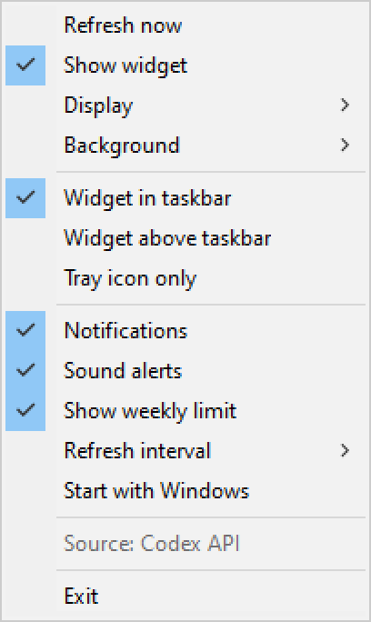
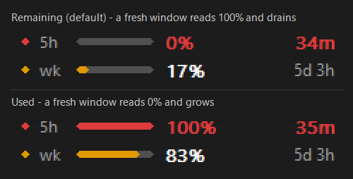
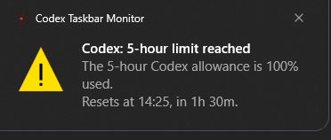

# Codex Taskbar Monitor

A lightweight native widget that lives **inside the Windows taskbar** and shows how much
**OpenAI Codex** allowance is left — the 5-hour window and the weekly window — with the
exact time until each reset, plus notifications (and sounds) when a limit is exhausted
and when it becomes available again.

Inspired by [Claude-Code-Usage-Monitor](https://github.com/CodeZeno/Claude-Code-Usage-Monitor),
but Codex-only, dependency-free, and with taskbar hosting that behaves properly on Windows 10.


## Features

| | |
| --- | --- |
| Codex usage | remaining (default) or used percentage for the 5-hour and weekly windows |
| Reset countdown | accurate to the second, in hours and minutes — `1h 02m`, weekly as `5d 3h` |
| Taskbar widget | the window is **parented into `Shell_TrayWnd`** (the same technique TrafficMonitor uses), not floating above the taskbar |
| Seamless background | transparent by default (color-key, no painted background at all); two alternatives available |
| Notifications | Windows toast when a limit is exhausted and when it becomes available again |
| Sound | synthesized cues: descending tones for "limit reached", rising arpeggio for "available again" |
| Tray icon | progress ring colored by state, tooltip with both windows |
| Menu | right-click the widget, or left/right-click the tray icon |
| Settings | refresh interval, notifications, sound, weekly row, display direction, placement mode, monitor, autostart |
| Resilience | widget is recreated after an `explorer.exe` restart; position and DPI re-checked every second |
| Footprint | one ~310 KB exe, ~3 MB private memory, no .NET, no VC++ Redistributable |

No analytics, no telemetry. The only network request is
`GET https://chatgpt.com/backend-api/wham/usage`, the endpoint the Codex CLI itself uses.

## Requirements

* Windows 10 (tested on 19045) or Windows 11, x64
* Codex CLI installed and signed in — the token is read from
  `%USERPROFILE%\.codex\auth.json` (or `%CODEX_HOME%\auth.json`)

## Running

```
CodexTaskbar.exe
```

The first poll happens immediately; afterwards it refreshes every 60 seconds (configurable),
plus one extra poll a couple of seconds after a reset moment so the "available again"
notification arrives on time.

| Action | Result |
| --- | --- |
| Left / right click the widget | menu |
| Left click the tray icon | show / hide the widget |
| Right click the tray icon | menu |
| Second launch of the exe | focuses the running instance instead of starting a duplicate |



## Display direction

Two modes, switchable from **Display** in the menu:

* **Remaining** — default. A fresh window reads `100%` and drains as you work, which is
  what you actually care about when deciding whether to start a task.
* **Used** — the classic "how much is spent" reading; a fresh window reads `0%`.

The bar, the percentage, the tray ring and the tooltip all follow the selected mode.
Severity colors (green → amber ≥ 70% used → red when exhausted) are derived from actual
consumption, so `Remaining` still turns red when nothing is left.

Stored as `display_mode` in the config file (`0` = remaining, `1` = used).



## Background

The widget never draws its own panel; **Background** in the menu offers three options:

| Mode | What it does |
| --- | --- |
| **Transparent** (default) | The window becomes layered and a magenta colour key marks every pixel that is not ink, so the real taskbar — including its acrylic tint, wallpaper blur and the 1px highlight line — shows through untouched. Text is rendered with grayscale antialiasing here, because colour-key transparency cannot carry per-pixel alpha. |
| **Auto (blend with taskbar)** | Samples a 16px strip of the actual taskbar next to the widget once per second (captured with `BitBlt`, not `GetPixel`) and repaints the background row by row with those exact colours. Fully antialiased ClearType text; a perfect match on uniform bars. |
| **Solid** | A flat colour from the current light/dark Windows theme. |

If the system refuses layered child windows, the app silently falls back to *Auto*. One consequence of the transparent mode: pixels that are not ink are click-through, so the menu is easier to reach by right-clicking the text, the bars or the tray icon.

Stored as `background` (`0` = auto, `1` = transparent, `2` = solid).

## Notifications and sound

Exactly one notification per state transition:

1. a window reaches 100% used → **"Codex: 5-hour limit reached"**, with the reset time and
   the time left ("Resets at 13:41, in 1h 30m"), plus three descending tones;
2. the reset time passes (or usage drops below 100%) → **"Codex: available again"**, plus a
   rising arpeggio.



To check notifications and audio without waiting for a real limit:

```
CodexTaskbar.exe --test        :: shows both notifications in sequence
CodexTaskbar.exe --test-free   :: shows only the "available again" notification
```

Turn the sound off with **Sound alerts** in the menu.

## Settings

Stored in `%APPDATA%\CodexTaskbar\config.ini`:

```ini
[general]
refresh_sec=60      ; API poll interval in seconds (minimum 15)
notify=1            ; toast notifications
sound=1             ; sound cues
show_weekly=1       ; second row with the weekly window
display_mode=0      ; 0 = remaining (default), 1 = used
background=1        ; 0 = auto (mirror taskbar), 1 = transparent (default), 2 = solid
placement=0         ; 0 = in taskbar, 1 = above taskbar, 2 = tray icon only
monitor=0           ; taskbar index for multi-monitor setups
widget_visible=1    ; show the widget
```

Autostart is toggled by **Start with Windows** (key
`HKCU\Software\Microsoft\Windows\CurrentVersion\Run\CodexTaskbar`).

## Why it really sits in the taskbar

`placement=0` (default) creates the widget as a **child window of `Shell_TrayWnd`**, placed
left of `TrayNotifyWnd` in the empty part of the bar. That is what makes it feel native: it
does not cover the bar, does not flicker when the bar appears or hides, does not steal clicks
from task buttons, and follows the bar on any screen edge.

This is the most fragile part of such apps, so several safeguards exist:

* a hidden **anchor window** owns the tray icon, timers and polling — it is not a child of
  the shell, so an `explorer.exe` restart does not kill the process;
* the widget is recreated on the shell's `TaskbarCreated` broadcast, and a 1-second watchdog
  verifies parent, size and z-order (re-asserting `HWND_TOP`);
* `placement=1` is an overlay fallback (topmost window over the taskbar) for systems where
  embedding is blocked by policy;
* `placement=2` keeps only the tray icon.

## Where the numbers come from

1. **Primary source** — the Codex CLI usage endpoint:
   `GET https://chatgpt.com/backend-api/wham/usage` with
   `Authorization: Bearer <access_token>`, `ChatGPT-Account-Id: <account_id>` and
   `User-Agent: codex-cli`. The token is read from `auth.json` and never written anywhere.
   The app reads `rate_limit.primary_window` (5 hours, `limit_window_seconds = 18000`) and
   `rate_limit.secondary_window` (weekly, `604800`).

2. **Fallback** — the local Codex session log
   (`%USERPROFILE%\.codex\sessions\**\rollout-*.jsonl`, last `rate_limits` entry). Used
   automatically when the API is unreachable or the token expired. In that case the menu and
   the tooltip say `Source: Codex session log` and the numbers only advance while you work in
   the Codex CLI.

If `auth.json` is missing or the token is stale, the widget shows *"Sign in to Codex CLI"* —
just run `codex` and sign in.

## Building from source

Requires Visual Studio 2019/2022 with the "Desktop development with C++" workload
(MSVC + Windows SDK).

```powershell
powershell -ExecutionPolicy Bypass -File build.ps1
```

The script locates `vcvars64.bat`, compiles resources (`src/app.rc`: icon + version info) and
links `build\CodexTaskbar.exe` against the static CRT (`/MT`), so the exe needs neither .NET
nor the VC++ Redistributable.

```
src/CodexTaskbar.cpp   ~1700 lines: WinHTTP client, JSON parser, GDI rendering, widget,
                       notifications, tray icon, menu, settings
src/app.rc             icon and VERSIONINFO
src/app.manifest       PerMonitorV2 DPI awareness, Windows 10 compatibility
src/app.ico            exe icon (generated by tools/make_icon.ps1)
build.ps1              one-command build
tools/*.ps1            helper scripts (icon generation, widget screenshot, menu capture)
docs/*.png             the screenshots used by this README
```

## Diagnostics

```
CodexTaskbar.exe --dump
```

Writes `%APPDATA%\CodexTaskbar\dump.txt` with API reachability, the data source, both
percentages, reset timestamps and the current time — handy when a number looks off.

## Limitations

* One Codex account (the profile in `auth.json`); no account switching.
* Vertical taskbars: the widget docks as a compact block at the bottom end — the layout is
  designed for a horizontal taskbar.
* Colors follow the system light/dark taskbar theme in *Solid* mode; the transparent and
  auto modes adapt to the bar automatically. There are no custom themes.
* Windows caches tray icons until the notification area is hovered once (shell behavior).
* Notifications are sent as toast balloons owned by the exe, so the header shows
  "CodexTaskbar.exe" rather than a store-style app name.

## License

MIT. See [LICENSE](LICENSE).
